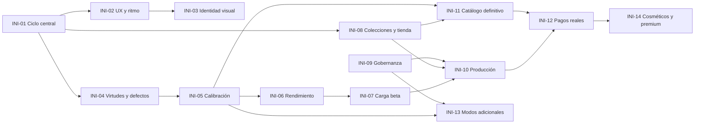

# Roadmap de Fútboosterdraft

**Estado**: propuesta, pendiente de aprobación · **Fecha**: 2026-10-28 · **Constitución**: 1.1.1

Este documento es la *spec de specs* del proyecto: agrupa las especificaciones de `specs/` en iniciativas de
producto, fija su orden y dice cuándo se da por cerrada cada una. No sustituye a las specs: cada iniciativa remite
a la suya, y las que aún no tienen spec DEBEN tenerla antes de implementarse (constitución, Principio X y
"Decisiones aún pendientes").

## Cómo leerlo

- **Identificadores**: `INI-NN`. Son estables: no se renumeran ni se reutilizan. Una iniciativa descartada se queda
  con su id y el estado *Descartada*.
- **Prioridad**: **P0** bloquea la beta abierta · **P1** necesaria para la beta · **P2** después de la beta ·
  **P3** exploratoria.
- **Estado** (se decide por la evidencia de los checklists de validación, no por que exista la spec):

  | Estado | Significado |
  |---|---|
  | **Implementada** | Código en `main` y todos sus criterios de éxito comprobados y registrados. |
  | **Implementada, sin validar** | Código en `main` y pruebas automáticas en verde, pero faltan comprobaciones con personas, en un entorno real o manuales. |
  | **Parcial** | Parte del alcance o de los criterios de éxito no se cumple todavía. |
  | **Pendiente** | Aprobada como necesidad, sin implementar. Puede tener spec o no. |
  | **Idea** | Mencionada en specs o en la constitución como futuro; no aprobada como requisito. |

- **Hecha** significa que se cumplen todos sus criterios de cierre. Al cerrar una iniciativa se actualiza su fila
  y, si procede, la constitución ("Decisiones resueltas").

## Resumen

| Id | Iniciativa | Specs | Prioridad | Estado | Depende de |
|---|---|---|---|---|---|
| [INI-01](#ini-01-ciclo-central-del-juego) | Ciclo central del juego | 001, 002, 003 | P0 | Implementada, sin validar | — |
| [INI-02](#ini-02-experiencia-de-juego-y-ritmo) | Experiencia de juego y ritmo | 002, 003 | P1 | Implementada, sin validar | INI-01 |
| [INI-03](#ini-03-identidad-visual-y-accesibilidad) | Identidad visual y accesibilidad | 004 | P1 | Implementada, sin validar | INI-02 |
| [INI-04](#ini-04-virtudes-defectos-y-modo-duelo) | Virtudes, defectos y modo Duelo | 005 | P1 | Implementada, sin validar | INI-01 |
| [INI-05](#ini-05-calibración-del-motor-y-de-los-npc) | Calibración del motor y de los NPC | 003, 005 | P0 | Parcial | INI-04 |
| [INI-06](#ini-06-rendimiento-del-motor) | Rendimiento del motor | 001, 002 | P1 | Parcial | INI-05 |
| [INI-07](#ini-07-carga-y-escalabilidad-de-la-beta) | Carga y escalabilidad de la beta | 001, 002, 003 | P0 | Parcial | INI-06 |
| [INI-08](#ini-08-colecciones-fragmentos-y-tienda) | Colecciones, fragmentos y tienda | 006 | P1 | Implementada, sin validar | INI-01 |
| [INI-09](#ini-09-gobernanza-y-documentación-al-día) | Gobernanza y documentación al día | — | P0 | Pendiente | — |
| [INI-10](#ini-10-preparación-para-producción) | Preparación para producción | sin spec | P0 | Pendiente | INI-07, INI-08, INI-09 |
| [INI-11](#ini-11-catálogo-de-cartas-definitivo) | Catálogo de cartas definitivo | sin spec (sigue a 006) | P1 | Pendiente | INI-08, INI-05 |
| [INI-12](#ini-12-pagos-reales) | Pagos reales | sin spec | P2 | Pendiente | INI-10, INI-11 |
| [INI-13](#ini-13-modos-de-juego-adicionales) | Modos de juego adicionales | sin spec | P3 | Idea | INI-05, INI-09 |
| [INI-14](#ini-14-cosméticos-y-versiones-premium) | Cosméticos y versiones premium de cartas | sin spec | P3 | Idea | INI-12 |

## Dependencias

**Camino crítico a la beta**: INI-05 → INI-06 → INI-07 → INI-10, con INI-09 en paralelo (es barata y desbloquea
INI-10 e INI-13).

---

## INI-01 Ciclo central del juego

- **Objetivo**: validar el ciclo draft → preparación → partido → torneo (constitución, Principio X).
- **Alcance**: draft de 3 sobres de 8 cartas con selección simultánea y circulación I-D-I; plantilla de 24;
  formación, once, posiciones y táctica; partido en simulación rápida y 2D con un único motor; torneos liga,
  playoff y mixto (asíncronos desde 002/FR-030); NPC de cuatro niveles; invitados y cuentas.
- **Specs**: [001](specs/001-draft-manager-mvp/spec.md) (US1–US6), [002](specs/002-mejoras-mvp/spec.md) US11
  (torneos asíncronos), [003](specs/003-mejoras-ux-simulacion/spec.md) US3 (modo de simulación por partido).
- **Prioridad / estado**: P0 · **Implementada, sin validar**.
- **Evidencia**: [001/checklists/validacion.md](specs/001-draft-manager-mvp/checklists/validacion.md): lint, typecheck,
  unitarias, integración, equivalencia rápida/2D (SC-008) y e2e en verde. Sin cerrar:
  - 001/SC-003: 5 personas nuevas completan draft y alineación en < 30 min sin ayuda.
  - Correo real de avisos con un proveedor SMTP (solo probado con Mailpit).
  - Reproducción 2D a 60 fps en un portátil medio con el navegador visible (002/FR-025b).
  - T144 sigue sin marcar en [001/tasks.md](specs/001-draft-manager-mvp/tasks.md) aunque la validación está registrada.
  - 001/SC-017 (carga) se trata en INI-07.
- **Criterios de cierre**:
  1. 001/SC-003 medido con al menos 5 personas y registrado en `validacion.md`.
  2. Aviso de correo recibido en un buzón externo real.
  3. 60 fps (nunca < 30) medidos en un portátil medio.
  4. T144 marcada.

## INI-02 Experiencia de juego y ritmo

- **Objetivo**: que jugar sea fluido: sin esperas, navegación clara, partido 2D creíble y preparación del equipo cómoda.
- **Alcance**: cartas legibles, botón «Siguiente», 2D fluida, penalizaciones de posición, «Finalizar partido»,
  barra de navegación, colocación libre, dorsales, goleadores, apertura de sobres (002 US1–US10); campo único de
  preparación, botones principales, gestión en el descanso, pantalla de resultado, campeón/eliminado, nombre y
  equipación, dificultad de partida Fácil/Normal/Difícil (003 US2, US4–US8, US10, US11, FR-038a).
- **Specs**: [002](specs/002-mejoras-mvp/spec.md), [003](specs/003-mejoras-ux-simulacion/spec.md).
- **Prioridad / estado**: P1 · **Implementada, sin validar**.
- **Evidencia**: hallazgos H1–H14 de la prueba con personas de la 003 corregidos y cubiertos por e2e
  ([003/checklists/validacion.md](specs/003-mejoras-ux-simulacion/checklists/validacion.md)). Sin cerrar:
  - 002: SC-001 (cartas con 5 personas), SC-009 (comparativa con la versión anterior), SC-007a (revisión visual de
    3 partidos a x2), FR-025b (60 fps) — [002/checklists/validacion.md](specs/002-mejoras-mvp/checklists/validacion.md); T159 abierta.
  - 003: SC-008, SC-011, SC-012, SC-013, SC-014, SC-016 y SC-019 pendientes de repetir tras los hallazgos; T133 abierta.
- **Criterios de cierre**:
  1. Los criterios con personas de 002 y 003 listados arriba medidos y registrados.
  2. T159 (002) y T133 (003) marcadas.
  3. Ningún hallazgo crítico abierto en la segunda ronda con personas.

## INI-03 Identidad visual y accesibilidad

- **Objetivo**: una identidad visual coherente, saber siempre qué hacer después y uso cómodo en móvil y con
  tecnologías de apoyo.
- **Alcance**: 004 US1–US5; guía [docs/diseno/DESIGN.md](docs/diseno/DESIGN.md).
- **Specs**: [004](specs/004-mejoras-visuales-diseno/spec.md).
- **Prioridad / estado**: P1 · **Implementada, sin validar**.
- **Evidencia**: lint de tokens, unitarias, 22 e2e de diseño (en CI) e integración en verde; tipografías dentro de
  presupuesto (SC-009). Sin cerrar:
  - T074: recorrer [checklists/visual.md](specs/004-mejoras-visuales-diseno/checklists/visual.md) a 1366 × 768 y 360 × 640.
  - T076: SC-003 (prueba de cinco segundos, 10 personas), SC-004 y SC-010 (5 personas); las tablas de
    [004/checklists/validacion.md](specs/004-mejoras-visuales-diseno/checklists/validacion.md) están vacías.
- **Criterios de cierre**: T074 y T076 hechas, con las tablas de `validacion.md` rellenas y SC-003, SC-004 y SC-010 cumplidos.
- **Nota**: conviene hacer la sesión con personas de INI-01, INI-02, INI-03 e INI-08 a la vez (ver "Decisiones").

## INI-04 Virtudes, defectos y modo Duelo

- **Objetivo**: rasgos positivos y negativos con efecto medible en el partido y un modo de torneo nuevo.
- **Alcance**: 005 US1–US6: «virtudes» en todo el juego, 15 defectos, modo «Duelo de jugadores», penaltis,
  lesiones y tarjetas creíbles, cuatro virtudes nuevas y [docs/juego/virtudes-y-defectos.md](docs/juego/virtudes-y-defectos.md).
- **Specs**: [005](specs/005-virtudes-defectos/spec.md).
- **Prioridad / estado**: P1 · **Implementada, sin validar**. Las 123 tareas están marcadas, pero no toda la
  validación pasa.
- **Evidencia**: [005/checklists/validacion.md](specs/005-virtudes-defectos/checklists/validacion.md): unitarias,
  equivalencia, integración, SC-004, SC-005, SC-010 y SC-011 en verde con n = 1.000. Sin cerrar:
  - 005/FR-051 en las virtudes: ρ = 0,54 con n = 1.000 y 0,45 con n = 500 (objetivo ≥ 0,6). Se trabaja en INI-05.
  - La propuesta de constitución 1.2.0 (vocabulario «virtudes y defectos», modo Duelo) no está aplicada: INI-09.
- **Criterios de cierre**: FR-051 cumplido en virtudes y defectos (lo cierra INI-05) y constitución 1.2.0 aplicada
  (lo cierra INI-09).

## INI-05 Calibración del motor y de los NPC

- **Objetivo**: que el motor 3.0.0 cumpla todos los criterios estadísticos de las specs 001 a 005, de modo que la
  estrategia sea determinante (Principios I y IV) y el CI no necesite excepciones.
- **Alcance**: parámetros de `packages/domain/src/parametros/v3.json`; criterios estadísticos mal planteados;
  comprobaciones que no se pueden medir con el tamaño de muestra actual.
- **Specs**: [003](specs/003-mejoras-ux-simulacion/spec.md) (T033, T034; [calibracion-motor.md](specs/003-mejoras-ux-simulacion/checklists/calibracion-motor.md),
  [calibracion-npc.md](specs/003-mejoras-ux-simulacion/checklists/calibracion-npc.md)), [005](specs/005-virtudes-defectos/spec.md) (FR-051, research R2).
- **Prioridad / estado**: P0 · **Parcial**.
- **Evidencia**:
  - NPC: 003/SC-010, SC-010a y SC-010b cumplidos en la ronda 4. **Hecho.**
  - Motor: calibración marcada como **abierta**. El CI pasa a `--pendientes` siete comprobaciones
    ([ci.yml](.github/workflows/ci.yml)): 002/SC-007a, 002/SC-008, 003/SC-009, SC-006a, 003/SC-006, 005/SC-011 y
    005/FR-051. Además falla 003/SC-001c (goles por torneo Core), cuyo criterio no es alcanzable con 28 partidos por torneo.
  - T036 (regenerar escenarios de `tools/fixtures`) está resuelta por el commit `29bf61e` y sus 12 pruebas pasan
    (comprobado el 2026-10-28), pero sigue sin marcar.
- **Criterios de cierre**:
  1. Decisión registrada sobre los criterios no medibles (003/SC-001c, regate de 003/SC-006): reformularlos en su
     spec o aceptar el fallo documentado.
  2. `pnpm balance --n 1000 --serie todas` pasa todas las comprobaciones vigentes con dos semillas.
  3. La lista `--pendientes` de `ci.yml` queda vacía.
  4. T033, T034 y T036 marcadas y `calibracion-motor.md` con estado **cerrada**.

## INI-06 Rendimiento del motor

- **Objetivo**: que el motor cumpla 002/FR-028a (≤ 25 ms por partido sin fotogramas y ≤ 40 ms con fotogramas en
  Node 22) para sostener torneos con muchos NPC.
- **Alcance**: optimización de `packages/engine` sin cambiar resultados (la equivalencia y las semillas deben seguir idénticas).
- **Specs**: [002](specs/002-mejoras-mvp/spec.md) FR-028a, T086.
- **Prioridad / estado**: P1 · **Parcial**. Medido: 82,9 ms (002), 103 ms (004) y 107 ms (005) sin fotogramas. El
  umbral bloqueante del CI se subió a 120 ms (commit `e850c11`) para que no falle, lo que no cumple el requisito.
- **Dependencia**: tras INI-05, porque calibrar cambia el coste por partido y optimizar antes obliga a medir dos veces.
- **Criterios de cierre**:
  1. `pnpm --filter @fbd/engine bench` ≤ 25 / 40 ms en la máquina de referencia (que hay que fijar y documentar),
     o FR-028a revisado en su spec con un objetivo justificado.
  2. `umbral-motor` del CI con el objetivo de FR-028a.
  3. `pnpm test:equivalence` en verde sin cambios en los resultados.
  4. T086 marcada.

## INI-07 Carga y escalabilidad de la beta

- **Objetivo**: demostrar 001/SC-017: 100 partidas simultáneas con los tiempos de respuesta del MVP.
- **Alcance**: rehacer `tools/load/beta-100.js` con el protocolo actual (un VU por humano) y medir en un entorno
  parecido al de producción.
- **Specs**: [001](specs/001-draft-manager-mvp/spec.md) SC-017 y SC-009; [002](specs/002-mejoras-mvp/tasks.md) T153;
  [003](specs/003-mejoras-ux-simulacion/tasks.md) T128.
- **Prioridad / estado**: P0 · **Parcial**. En la 001 no se cumplió (entrega del sobre p95 1,99 s frente a < 1 s,
  «Seguir» → final p95 6,2 s frente a < 3 s). Desde la 002 el guion no se ha vuelto a ejecutar con el protocolo
  nuevo, y su resultado de la 002 apunta a un fallo del guion, no del servidor.
- **Criterios de cierre**:
  1. Guion actualizado al protocolo vigente (T153 y T128 marcadas; son la misma tarea).
  2. 001/SC-017 cumplido, con servidor, base de datos y generador de carga en máquinas separadas, y resultado registrado.
  3. 0 errores de WebSocket atribuibles al servidor.

## INI-08 Colecciones, fragmentos y tienda

- **Objetivo**: la estructura de colecciones y el esqueleto de la monetización, respetando que todos juegan con las
  mismas reglas de draft (Principio VII).
- **Alcance**: 006 US1–US7: colección propia y activa con su mínimo, fragmentos (torneos ganados y desfragmentar),
  tienda de sobres, colecciones y fragmentos con **pago simulado**, cartas con bandera, escudo e imagen de fondo.
- **Specs**: [006](specs/006-preparacion-bd-cartas/spec.md).
- **Prioridad / estado**: P1 · **Implementada, sin validar**. No hay `checklists/validacion.md` de la 006.
- **Evidencia**: 110 de 112 tareas marcadas; tests de integración estabilizados (commits `c56b889`, `f1ab80b`). Sin cerrar:
  - T103: escenarios manuales A–O de [quickstart.md](specs/006-preparacion-bd-cartas/quickstart.md), incluido 360 px en «Colección» y «Tienda».
  - T087: escudos oficiales; desactivados (`ESCUDOS_ACTIVOS = false`) por licencia sin revisar. **Bloquea producción**
    ([docs/despliegue.md](docs/despliegue.md)).
  - 006/SC-007 (idempotencia de compras con dobles pulsaciones y cortes) debe quedar registrado en la validación.
- **Criterios de cierre**:
  1. `specs/006-preparacion-bd-cartas/checklists/validacion.md` creado con pruebas automáticas y escenarios A–O.
  2. T103 marcada.
  3. Escudos con licencia revisada y activados, o retirados de FR-044 por decisión registrada (T087).

## INI-09 Gobernanza y documentación al día

- **Objetivo**: que la constitución, el README y los estados de las specs reflejen lo que hay en `main`.
- **Alcance** (sin código):
  - Aplicar con `/speckit-constitution` las enmiendas pendientes: la PATCH 1.0.5 de la 003
    ([propuesta](specs/003-mejoras-ux-simulacion/propuesta-constitucion-1.0.5.md); su TODO sigue en el Sync Impact
    Report) y la MINOR 1.2.0 de la 005 ([propuesta](specs/005-virtudes-defectos/propuesta-constitucion-1.2.0.md)).
    Ambas se redactaron sobre versiones anteriores (1.0.4 y 1.1.0) y hay que rebasarlas sobre la 1.1.1.
  - Registrar el modo «Duelo de jugadores» (005) como decisión resuelta: hoy la constitución dice que los modos
    adicionales a liga, playoff y mixto están pendientes, y ya hay uno implementado.
  - Actualizar el README: el estado dice «MVP implementado», la tabla de documentación solo enlaza la 001 y la de
    `tools/balance` se queda en la 003.
  - Cambiar `**Status**: Draft` de las specs según este roadmap y añadir este documento al `CLAUDE.md`.
- **Prioridad / estado**: P0 · **Pendiente**. Es barata y quita contradicciones que confunden a quien lea la constitución.
- **Criterios de cierre**: constitución ≥ 1.2.0 sin TODOs en el Sync Impact Report; README con el estado de este
  roadmap; ninguna spec con estado `Draft` si está implementada.

## INI-10 Preparación para producción

- **Objetivo**: poder abrir la beta a personas ajenas al proyecto con datos persistentes y sin riesgos legales abiertos.
- **Alcance propuesto** (a concretar en su spec): despliegue según [docs/despliegue.md](docs/despliegue.md); SMTP
  real; copias de seguridad y restauración probadas; registros y métricas mínimos para diagnosticar partidas
  bloqueadas; revisión de seguridad de autenticación y de la tienda; textos legales (privacidad, condiciones);
  resolución de los riesgos que bloquean producción (escudos).
- **Specs**: ninguna. **Requiere spec nueva** (p. ej. `007-beta-produccion`).
- **Prioridad / estado**: P0 · **Pendiente**.
- **Dependencias**: INI-07 (la carga debe aguantar), INI-08 (escudos), INI-09.
- **Criterios de cierre**: los criterios de éxito de su spec, como mínimo: despliegue reproducible desde la imagen
  Docker, restauración de una copia probada, ningún riesgo abierto que bloquee producción en `docs/despliegue.md`.

## INI-11 Catálogo de cartas definitivo

- **Objetivo**: pasar del Core ficticio de 300 cartas y las 75 de prueba al catálogo real, que es para lo que la 006
  preparó el modelo («fase previa a la creación de la base de datos de las cartas»).
- **Alcance propuesto**: contenido de Core y de las primeras colecciones de pago (40–50 cartas cada una); imágenes
  propias de GOAT y Legendarias; historias de las cartas; validación de equilibrio del nuevo pool con `pnpm balance --serie core`;
  política de derechos de imagen y nombres de jugadores reales, si se usan.
- **Specs**: ninguna (la base es [006](specs/006-preparacion-bd-cartas/spec.md) FR-001 a FR-012). **Requiere spec nueva**.
- **Prioridad / estado**: P1 · **Pendiente**.
- **Dependencias**: INI-08 (modelo de colecciones) e INI-05 (el equilibrio del catálogo se mide con el motor ya calibrado).
- **Criterios de cierre**: los de su spec, como mínimo: `pnpm seed` carga el catálogo nuevo; validación del catálogo
  en verde; serie Core dentro de los criterios estadísticos; derechos de todo el contenido revisados.

## INI-12 Pagos reales

- **Objetivo**: sustituir el pago simulado (006/FR-031) por una pasarela real con facturas.
- **Alcance propuesto**: pasarela, facturación, reembolsos, conciliación con el saldo de fragmentos y auditoría de compras.
- **Specs**: ninguna. **Requiere spec nueva**; debe respetar el Principio VII (sin ventajas fuera de las reglas de draft).
- **Prioridad / estado**: P2 · **Pendiente**.
- **Dependencias**: INI-10 (entorno de producción) e INI-11 (algo que vender).
- **Criterios de cierre**: los de su spec, como mínimo: 006/SC-007 (cada compra se cobra una vez) con la pasarela real
  en su entorno de pruebas, y revisión de seguridad aprobada.

## INI-13 Modos de juego adicionales

- **Objetivo**: nuevos modos además de liga, playoff, mixto y Duelo.
- **Specs**: ninguna. La constitución lo lista en "Decisiones aún pendientes"; no está aprobado como requisito.
- **Prioridad / estado**: P3 · **Idea**.
- **Dependencias**: INI-05 (sin calibrar, un modo nuevo hereda los desequilibrios) e INI-09 (registrar Duelo primero).
- **Criterios de cierre**: no se definen hasta que exista una spec aprobada.

## INI-14 Cosméticos y versiones premium de cartas

- **Objetivo**: ampliar la tienda con cosméticos (006/FR-033) y versiones premium de las cartas (006/FR-003).
- **Specs**: ninguna; el modelo de la 006 ya lo admite sin rediseñarse.
- **Prioridad / estado**: P3 · **Idea**.
- **Dependencias**: INI-12.
- **Criterios de cierre**: no se definen hasta que exista una spec aprobada; debe respetar el Principio VII.

---

## Decisiones tomadas en esta propuesta

1. **Iniciativas por objetivo de producto, no una por spec.** Las specs 002 y 003 mezclan UX, motor y calibración;
   separarlas (INI-02, INI-05) deja ver que lo que bloquea la beta es la calibración, no la interfaz.
2. **«Implementada, sin validar» como estado propio.** Casi todas las specs tienen las tareas de código hechas y solo
   faltan las de validación con personas o en entorno real. Contarlas como hechas ocultaría trabajo; contarlas como
   parciales mezclaría eso con requisitos que no se cumplen (FR-028a, SC-017).
3. **Calibración antes que rendimiento.** Optimizar el motor y luego recalibrarlo obliga a medir dos veces.
4. **Una única sesión con personas** para INI-01, INI-02, INI-03 e INI-08: comparten perfil de participantes y
   equipo, y la 004 ya prevé comparar con una versión anterior.
5. **Criterios no medibles se reformulan en su spec**, no se aflojan en el CI. Hoy el CI tolera siete comprobaciones
   con `--pendientes` y un umbral de 120 ms frente a los 25 ms del requisito: este roadmap no las da por cumplidas.
6. **Lo que no tiene spec no se implementa** (INI-10 a INI-14): primero `/speckit-specify`.

## Comprobaciones pendientes (resumen)

| Comprobación | Dónde | Iniciativa |
|---|---|---|
| 7 comprobaciones de `balance` en `--pendientes` y 003/SC-001c | `.github/workflows/ci.yml`, `calibracion-motor.md` | INI-05 |
| FR-028a: 25 / 40 ms por partido (CI a 120 ms) | `pnpm --filter @fbd/engine bench` | INI-06 |
| 001/SC-017: carga de 100 partidas | `tools/load/beta-100.js` | INI-07 |
| Pruebas con personas: 001/SC-003; 002/SC-001, SC-009, SC-007a; 003/SC-008, SC-011–SC-014, SC-016, SC-019; 004/SC-003, SC-004, SC-010 | checklists `validacion.md` | INI-01 a INI-03 |
| 60 fps en un portátil medio con el navegador visible | 002/FR-025b | INI-01, INI-02 |
| Correo con SMTP real | 001 escenario E | INI-01, INI-10 |
| Escenarios manuales A–O de la 006 | `specs/006-preparacion-bd-cartas/quickstart.md` | INI-08 |
| Licencia de los escudos | `docs/despliegue.md` | INI-08, INI-10 |
| Tests intermitentes: `torneo-asincrono` con la máquina cargada; `torneo.spec.ts` y la regla de 10 minutos sin conexión con el reloj simulado | 002, 003 y 004 `validacion.md` | INI-07 |
| Tareas hechas sin marcar: T036 (003), T144 (001) | `tasks.md` | INI-05, INI-01 |
